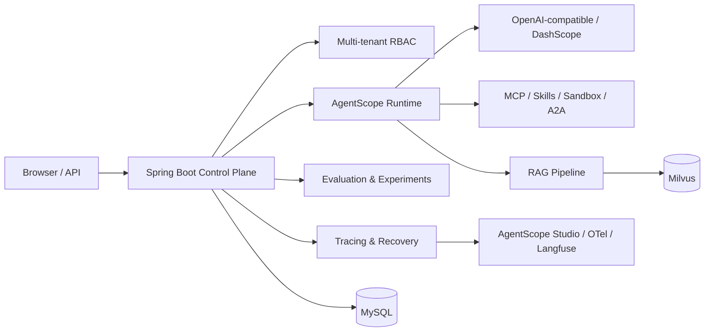

<div align="center">

# AgentForge Control Plane

简体中文 · [English](README_EN.md)

**面向 Java 团队的 AI Agent 控制面：在一个 Web 控制台中构建、调试、评测、发布和治理 Agent。**

[](https://github.com/JackWangbl/agentforge-control-plane-java/actions/workflows/ci.yml)
[](https://openjdk.org/projects/jdk/21/)
[](https://spring.io/projects/spring-boot)
[](https://github.com/agentscope-ai/agentscope-java)
[](CONTRIBUTING.md)

[快速开始](#-5-分钟快速开始) · [核心能力](#-核心能力) · [架构](#-架构) · [本地开发](#-本地开发) · [参与贡献](#-参与贡献)

</div>


AgentForge Control Plane 基于 Spring Boot 与 AgentScope Java，覆盖 Agent 从配置、工具接入、RAG、调试，到评测、A/B 实验、可观测与失败恢复的完整生命周期。它适合希望沿用 Java 技术栈，又不想从零搭建 Agent 管理后台的团队。

> 如果这个项目对你有帮助，欢迎点一个 Star。它能让更多 Java Agent 开发者找到这个项目，也能帮助我们判断优先建设哪些能力。

## ✨ 核心能力

| 能力 | 你可以做什么 |
| --- | --- |
| Agent 全生命周期 | 配置提示词、模型、技能、MCP、知识库与版本发布 |
| 可视化调试 | 与 Agent 实时对话，同时查看模型、工具与 RAG 执行链路 |
| 多 Agent 编排 | 通过工作流、Supervisor、A2A 与外部 HTTP Agent 组织协作 |
| RAG 知识库 | 解析 PDF、DOCX、HTML、CSV、Markdown，自动分块并使用 Milvus 混合检索 |
| 评测与实验 | 管理数据集，运行回归/性能测试，比较版本并执行 A/B 流量实验 |
| 可观测性 | 查询会话、Token、延迟、成功率，接入 AgentScope Studio、OTel 与 Langfuse |
| 项目排查 | 内置「项目排查」Agent，对照启动报错并只读查看会话、失败记录和日志 |
| 可靠执行 | 检查点、失败案例、脱敏、重试与人工触发的恢复流程 |
| 企业治理 | 多租户、RBAC、资源可见性、沙箱策略和访问审计 |

## 🚀 5 分钟快速开始

最省事的体验方式是 Docker Compose。它会启动 MySQL、自动创建本地演示库并构建应用；不需要手工导入 SQL。

```bash
git clone https://github.com/JackWangbl/agentforge-control-plane-java.git
cd agentforge-control-plane-java
./scripts/docker-up.sh
```

看到 `Started AgentForgeApplication` 后访问：

- 控制台：<http://127.0.0.1:8080>
- 健康检查：<http://127.0.0.1:8080/api/health>

第一次打开可以直接以访客身份体验。也可以使用仅供本机演示的管理员账号：

```text
用户名：linmo
密码：admin123
```

停止服务：

```bash
docker compose down
```

启动脚本会在首次运行时生成随机数据库密码，保存到 Git 忽略的 `.docker-secrets/`，并以 Docker secrets 文件挂载给 MySQL 与 Spring Boot。仓库里没有固定数据库密码，也不会使用你的真实数据库凭证。

> Docker 快速开始使用 `bootstrap` 配置让 Hibernate 为全新数据库创建基础表。该配置只用于本地空库，不要对生产数据库启用。示例登录账号仍是公开的，禁止直接用于公网部署。

Milvus 是知识库向量检索的可选依赖；不使用 RAG 时无需启动。其余 Agent、工作流、评测和控制台能力可以先行体验。

## 🏗 架构



技术栈：Java 21、Spring Boot 3.5、AgentScope Java 2、MySQL 8、Milvus 2.5、PDFBox 与 Apache POI。控制台为零 Node.js 构建依赖的原生 HTML/CSS/JavaScript 页面。

## 🧑‍💻 本地开发

### 环境要求

- JDK 21+
- Maven 3.9+
- MySQL 8+
- 可选：Milvus 2.5，用于知识库检索

### 1. 创建数据库

```sql
CREATE DATABASE agentforge CHARACTER SET utf8mb4 COLLATE utf8mb4_unicode_ci;
CREATE USER 'agentforge_app'@'%' IDENTIFIED BY '请换成你自己的密码';
GRANT ALL PRIVILEGES ON agentforge.* TO 'agentforge_app'@'%';
FLUSH PRIVILEGES;
```

### 2. 配置环境变量

```bash
cp .env.example .env
```

编辑 `.env` 中的 `DATABASE_URL`。文件已被 Git 忽略，不要把真实凭证提交到仓库。

### 3. 首次启动

对全新的本地空库，使用 `bootstrap` 配置自动创建基础表：

```bash
mvn spring-boot:run -Dspring-boot.run.profiles=bootstrap
```

后续启动可以使用：

```bash
mvn spring-boot:run
```

如果你使用已有控制面数据库，不要启用 `bootstrap`；应用的增量迁移器只会补充新增表和列，不会清空已有数据。

### 4. 运行测试

```bash
mvn test
```

打包运行：

```bash
mvn -DskipTests package
java -jar target/agentforge-control-plane-1.0.0.jar
```

## 🔌 接入模型与知识库

1. 用管理员账号进入「模型配置」，添加一个对话模型。支持 OpenAI 兼容端点，也支持 DashScope。
2. 在 Agent 编辑页绑定模型，然后到「Agent 调试台」开始对话。
3. 如需 RAG，在「向量数据库」添加 Milvus 并设为默认，再创建知识库并选择向量模型。
4. 上传 `txt`、`md`、`html`、`csv`、`docx` 或 `pdf` 文件；单文件上限 16 MB。
5. 将知识库绑定到 Agent。检索过程会作为 `search_documents` 工具调用显示在执行链路中。

对话、向量和重排序模型的密钥可以在控制台中配置。不要把真实 API Key 写入代码、截图或 Issue。

<details>
<summary><strong>常用配置项</strong></summary>

| 变量 | 作用 |
| --- | --- |
| `AGENTSCOPE_STUDIO_URL` | AgentScope Studio 地址 |
| `OTEL_EXPORTER_OTLP_ENDPOINT` | OpenTelemetry 导出地址 |
| `LANGFUSE_PUBLIC_KEY` / `LANGFUSE_SECRET_KEY` | Langfuse 追踪凭证 |
| `AUTH_DEV_USER` | 本地开发免登录；公网环境必须留空 |
| `WORKSPACES_DIR` | Agent 会话和执行链路目录 |
| `RAG_FILES_DIR` | 知识库上传原文目录 |
| `ALLOW_UNSAFE_LOCAL_SANDBOX` | 允许无 Docker 的本机命令执行，默认 `false` |
| `SANDBOX_DEFAULT_IMAGE` | 默认沙箱镜像，默认 `python:3.11-slim` |
| `BROWSER_ALLOW_PRIVATE_NETWORK` | 是否允许浏览器工具访问内网，默认 `false` |

</details>

## 📁 项目结构

```text
src/main/java/com/agentforge/controlplane
├── access          # 登录、RBAC、多租户与试用身份
├── agent           # AgentScope、A2A、多 Agent 与工具运行时
├── eval            # 数据集与评测
├── experiment      # A/B 实验
├── memory          # 长短期记忆与上下文压缩
├── rag             # 文档清洗、分块、向量检索与 GraphRAG
├── recovery        # 检查点、失败案例与恢复执行
├── runtime         # MCP、浏览器、HTTP 与沙箱运行时
├── web             # HTTP API
├── config          # 配置与数据库增量迁移
└── seed            # 本地演示数据
src/main/resources/static    # Web 控制台
docs/                        # 设计与专题文档
```

## 🗺 Roadmap

- [ ] 发布稳定的数据库迁移版本与升级指南
- [ ] 补充英文文档和模型供应商配置示例
- [ ] 提供 Milvus 可选的完整 Compose 开发栈
- [ ] 增加端到端测试和演示视频
- [ ] 完善生产部署、反向代理与安全加固指南

欢迎在 [Issues](https://github.com/JackWangbl/agentforge-control-plane-java/issues) 中提出场景或认领任务。

## 🤝 参与贡献

请先阅读 [CONTRIBUTING.md](CONTRIBUTING.md)。Bug 报告尽量提供最小复现步骤、Java/MySQL 版本和已脱敏日志；UI 修改请附前后截图。

安全问题请不要公开发 Issue，按照 [SECURITY.md](SECURITY.md) 私下报告。

## 📷 更多截图

<details>
<summary>展开查看控制台截图</summary>


</details>

## ⚠️ License

仓库目前还没有许可证。在维护者选择并添加 LICENSE 前，代码默认不授予复制、修改或再分发权限。若希望真正建立开源社区，建议尽快在 Apache-2.0 与 MIT 中明确选择一种。
