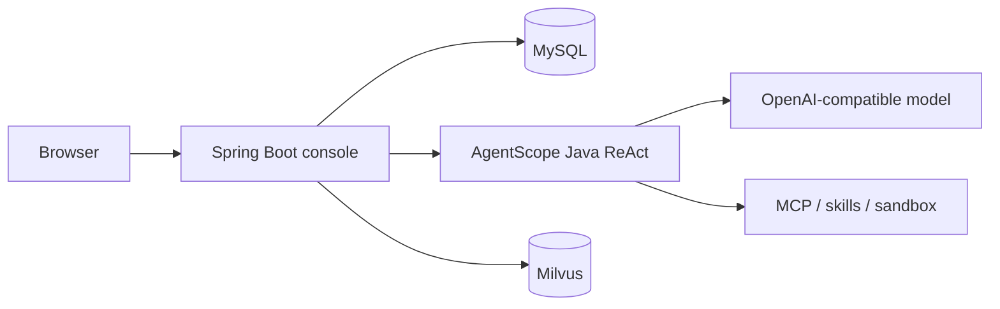

# AgentForge Control Plane

[中文说明](README_zh.md)

[](LICENSE)
[](https://openjdk.org/)
[](https://spring.io/projects/spring-boot)
[](https://github.com/agentscope-ai/agentscope-java)

Self-hosted console for teams building agents on [AgentScope Java](https://github.com/agentscope-ai/agentscope-java). One Spring Boot process manages agents, models, knowledge bases, MCP tools, evaluations, and traces. The browser talks to this app. The agent loop is AgentScope's ReAct runtime.

Java teams that have already chosen AgentScope usually still need a place to operate it: who can edit an agent, which model and knowledge base it uses, what happened in a session, and whether a change regressed. AgentForge is that console.


Open http://127.0.0.1:8080 and try it before logging in. A trial identity can spend 10,000 tokens. After that, sign in. Knowledge-base search needs Milvus. Chat needs an OpenAI-compatible model filled in under model settings.

## Who it is for

- A Java 21 / Spring Boot team that wants AgentScope agents behind a browser, with tenants and roles.
- Someone who already debugs with AgentScope Studio and now needs agents, tools, knowledge, evals, and an audit trail in the same place.
- A group comparing a Python app platform with a stack they can run next to the rest of their Java services.

## What you can do

| Area | What it covers |
| --- | --- |
| Agents | System prompt, model, skills, MCP, knowledge bases, sandbox, and an external HTTP agent |
| Multi-agent | Agents call each other over A2A. A supervisor can dispatch work |
| Debug console | Chat with the agent. The right side shows the tool trace for that turn |
| Knowledge | Upload txt, md, html, csv, docx, or pdf. Chunk, embed, and search in Milvus, with optional rerank |
| Memory | Long-term memory, plus context compression by message count and token budget |
| Evals | Datasets, required tools, repeated runs, and a failure-case path that can retry |
| Experiments | Split traffic across agent variants by weight |
| Access | Tenants, roles, members, visit history, and an IP block list |
| Sandbox | Run code and commands away from the console process |

The pages are server-rendered and live in `src/main/resources/static`.

## Quick start

You need JDK 21, Maven 3.9, and Docker. This path creates tables in an **empty** MySQL. Point it at a database that already has control-plane data and Hibernate will alter that schema.

```bash
docker compose up -d
cp .env.example .env
SPRING_PROFILES_ACTIVE=demo mvn spring-boot:run
```

Wait until the MySQL health check is green and the log says `Started AgentForgeApplication`. Then open http://127.0.0.1:8080.

The process listens on `127.0.0.1:8080` only. Seed users are created when those usernames are missing. Change the passwords before anyone else can reach the machine.

| Username | Initial password | Role |
| --- | --- | --- |
| `linmo` | `admin123` | Platform admin |
| `developer` | `dev123` | Agent developer |
| `auditor` | `audit123` | Read sessions and traces |
| `demo` | `demo123` | Tenant admin of the demo tenant |

Full setup, the shared-database path, model providers, and Milvus are in [docs/getting-started.md](docs/getting-started.md).

## How the pieces sit



MySQL holds tenants, agents, sessions, and config. Milvus holds chunks. Uploaded files stay on disk under `rag-files/`. Per-agent workspaces keep the trace you see after a refresh.

## Stack

- Java 21, Spring Boot 3.5, Maven
- AgentScope Java 2.0 (ReActAgent, OpenAI-compatible APIs, DashScope, A2A)
- MySQL 8
- Milvus 2.5 when you want retrieval
- PDFBox and Apache POI for documents

## More of the console


## Layout

```text
src/main/java/com/agentforge/controlplane
├── access          sign-in, roles, trial identity
├── agent           AgentScope runtime and tool calls
├── rag             clean, chunk, retrieve, rerank
├── web             HTTP API and pages
├── config          datasource rewrite, schema gaps filled at startup
└── seed            default tenant, roles, and users
src/main/resources/static    console pages
workspaces/                  sessions and traces per agent
rag-files/                   original uploads
```

## Contributing

Issues and pull requests are welcome in Chinese or English. See [CONTRIBUTING.md](CONTRIBUTING.md).

The code is [Apache-2.0](LICENSE). Release notes are in [CHANGELOG.md](CHANGELOG.md). A star helps other Java teams find the project.
