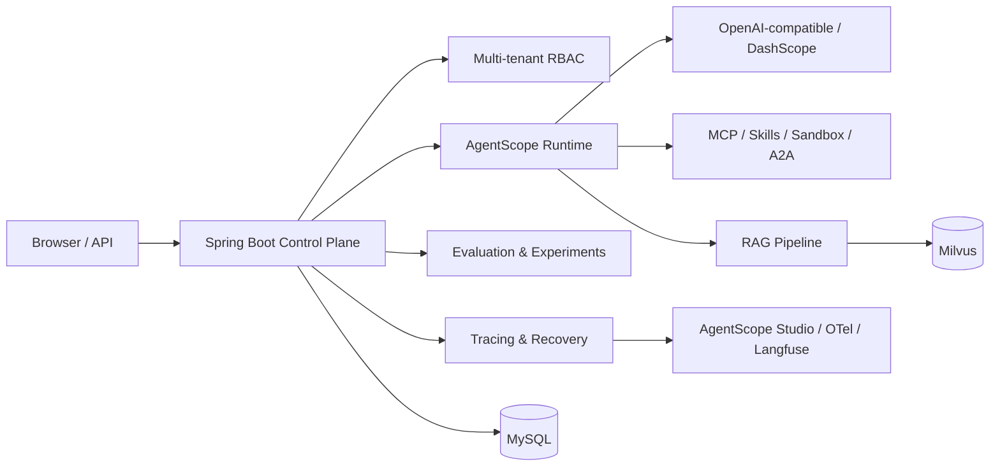

<div align="center">

# AgentForge Control Plane

[简体中文](README.md) · English

**A Java-native control plane for building, debugging, evaluating, releasing, and governing AI agents.**

[](https://github.com/JackWangbl/agentforge-control-plane-java/actions/workflows/ci.yml)
[](https://openjdk.org/projects/jdk/21/)
[](https://spring.io/projects/spring-boot)
[](https://github.com/agentscope-ai/agentscope-java)

</div>


AgentForge Control Plane combines Spring Boot and AgentScope Java into a web console for the complete agent lifecycle. It is designed for teams that want to keep their Java stack while avoiding the cost of building agent management, RAG, evaluation, observability, and governance from scratch.

## Highlights

- Configure prompts, models, skills, MCP servers, knowledge bases, and releases.
- Debug agents in a chat playground with model, tool, and RAG traces.
- Orchestrate multi-agent workflows with supervisors, A2A, and external HTTP agents.
- Parse PDF, DOCX, HTML, CSV, and Markdown into a Milvus-backed RAG pipeline.
- Run datasets, regression/performance evaluations, and weighted A/B experiments.
- Inspect sessions, token usage, latency, recovery checkpoints, and failure cases.
- Integrate AgentScope Studio, OpenTelemetry, and Langfuse.
- Govern multiple tenants with RBAC, resource visibility, audit data, and sandbox policies.

## Quick start

Docker Compose starts MySQL, creates a fresh local schema, builds the application, and loads demo data:

```bash
git clone https://github.com/JackWangbl/agentforge-control-plane-java.git
cd agentforge-control-plane-java
./scripts/docker-up.sh
```

Open <http://127.0.0.1:8080>. You can continue as a guest or use the local demo administrator:

```text
username: linmo
password: admin123
```

On first run, the script generates random database passwords under the Git-ignored `.docker-secrets/` directory and mounts them as Docker secrets. No fixed database password or personal database credential is stored in the repository.

The demo login and the `bootstrap` profile are for a new local database only. Do not use them in a public or production deployment. Milvus is optional unless you want to use knowledge-base retrieval.

## Architecture



Stack: Java 21, Spring Boot 3.5, AgentScope Java 2, MySQL 8, Milvus 2.5, PDFBox, and Apache POI. The web console uses native HTML, CSS, and JavaScript with no Node.js build step.

## Local development

Install JDK 21+, Maven 3.9+, and MySQL 8. Copy the safe configuration template and update its database URL:

```bash
cp .env.example .env
mvn spring-boot:run -Dspring-boot.run.profiles=bootstrap
```

Use `bootstrap` only for a brand-new local database. For an existing control-plane database, run `mvn spring-boot:run` without that profile.

Run the test suite before submitting changes:

```bash
mvn test
```

See the [Chinese README](README.md) for model, RAG, configuration, and project-structure details. Contributions are welcome—start with [CONTRIBUTING.md](CONTRIBUTING.md), and report vulnerabilities privately as described in [SECURITY.md](SECURITY.md).

## License status

This repository does not have a license yet. Until the maintainer adds one, the source is visible but no permission to copy, modify, or redistribute it is granted. Choosing an explicit license is the highest-priority remaining open-source task.
