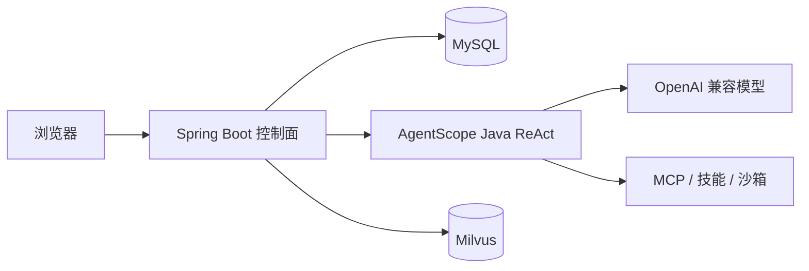

# AgentForge Control Plane（Java）

[English](README.md)

[](LICENSE)
[](https://openjdk.org/)
[](https://spring.io/projects/spring-boot)
[](https://github.com/agentscope-ai/agentscope-java)

给已经选定 [AgentScope Java](https://github.com/agentscope-ai/agentscope-java) 的团队用的自托管控制台。一个 Spring Boot 进程里管理 Agent、模型、知识库、MCP、评测和会话。浏览器访问这个控制面，智能体循环走 AgentScope 的 ReAct 运行时。

选了 AgentScope 之后，通常还缺一块操作台：谁能改 Agent、绑了哪个模型和知识库、某次会话里调了什么工具、改完有没有退步。AgentForge 就是这块控制台。


打开 http://127.0.0.1:8080 可以先试用，不必登录。试用身份累计 10000 Token 之后需要登录。知识库检索要另起 Milvus。对话要先在「模型配置」里填一个 OpenAI 兼容模型。

## 适合谁

- Java 21 / Spring Boot 团队，希望 AgentScope 智能体有浏览器、租户和角色。
- 已经用 AgentScope Studio 看轨迹，还想把 Agent、工具、知识库、评测和审计放在一处。
- 在「一套 Python 应用平台」和「跟现有 Java 服务放在一起」之间做选择的小组。

## 能做什么

| 模块 | 说明 |
| --- | --- |
| Agent | 系统提示词、模型、技能、MCP、知识库、沙箱，也可以接入外部 HTTP Agent |
| 多智能体 | Agent 之间用 A2A 互调，主管可以把任务分出去 |
| 调试台 | 用这个 Agent 绑定的模型对话，右侧是这一轮的工具链路 |
| 知识库 | 上传 txt、md、html、csv、docx、pdf。清洗、分块后写入 Milvus，可选重排序 |
| 记忆 | 长期记忆，以及按条数和 Token 预算做上下文压缩 |
| 评测 | 数据集、必调工具、重复跑，失败案例可以再试一次 |
| A/B | 按权重把流量分到不同 Agent |
| 权限 | 租户、角色、成员、访问记录和 IP 拉黑 |
| 沙箱 | 把代码和命令隔离开控制面进程 |

页面是服务端渲染的，在 `src/main/resources/static`。

## 最快试用

需要 JDK 21、Maven 3.9 和 Docker。下面这条路径会在**空的** MySQL 里建表。如果地址指到已经有控制面数据的库，Hibernate 会改那份表结构。

```bash
docker compose up -d
cp .env.example .env
SPRING_PROFILES_ACTIVE=demo mvn spring-boot:run
```

等 MySQL 健康检查通过，日志出现 `Started AgentForgeApplication`，打开 http://127.0.0.1:8080 。

服务只监听 `127.0.0.1:8080`。下面这些用户不存在时，启动会补上。机器一旦别人也能访问，先改掉密码。

| 用户名 | 初始密码 | 角色 |
| --- | --- | --- |
| `linmo` | `admin123` | 平台管理员 |
| `developer` | `dev123` | Agent 开发者 |
| `auditor` | `audit123` | 查看会话和链路 |
| `demo` | `demo123` | 演示租户的租户管理员 |

接到已有库、配置模型、启动 Milvus，写在 [docs/getting-started.md](docs/getting-started.md)。

## 各部分怎么接



MySQL 存租户、Agent、会话和配置。Milvus 存分块。上传的原文在 `rag-files/`。每个 Agent 的执行链路在 `workspaces/`，刷新调试台还能看到同一次会话。

## 技术栈

- Java 21，Spring Boot 3.5，Maven
- AgentScope Java 2.0（ReActAgent、OpenAI 兼容接口、DashScope、A2A）
- MySQL 8
- 要检索时用 Milvus 2.5
- 文档解析用 PDFBox 和 Apache POI

## 更多界面


## 目录

```text
src/main/java/com/agentforge/controlplane
├── access          登录、权限、试用身份
├── agent           AgentScope 运行时和工具调用
├── rag             清洗、分块、向量检索、重排序
├── web             HTTP 接口和页面
├── config          数据源改写、启动时补表
└── seed            默认租户、角色和账号
src/main/resources/static    控制台页面
workspaces/                  每个 Agent 的会话和执行链路
rag-files/                   上传的原始文件
```

## 参与

问题和 Pull Request 用中文或英文都可以，见 [CONTRIBUTING.md](CONTRIBUTING.md)。

代码使用 [Apache-2.0](LICENSE)。Star 能让其他 Java 团队更快找到这个项目。
